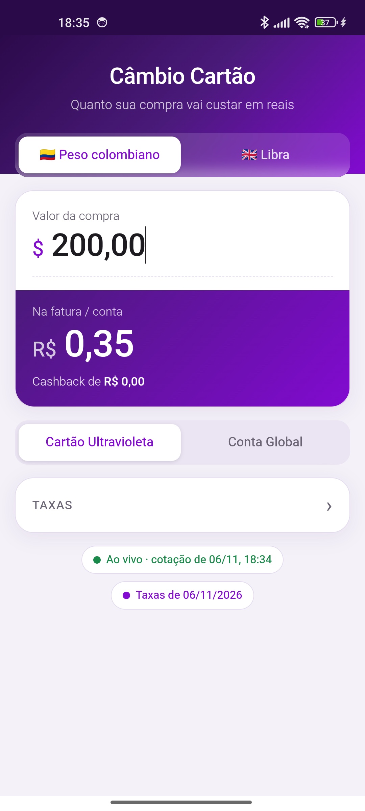

<div align="center">

# ⇄ nu**rate**

**Quanto sua compra no exterior custa em reais no Nubank, com spread, IOF, cashback e saque já incluídos.**

[](https://raphaelfuchter.github.io/NuRate/)
[](https://github.com/raphaelfuchter/NuRate/releases/latest/download/NuRate.apk)
[](#-moedas)
[](https://creativecommons.org/licenses/by/4.0/)



</div>

---

## ✨ Recursos

- 🌎 **41 moedas com cotação ao vivo** (AwesomeAPI), com bandeira, símbolo e nome em português.
- ⭐ **2 moedas favoritas** na tela, escolhidas por você. Troque pelo botão ⇄ e inverta a ordem com ⇅.
- 💳 **Duas modalidades:** Cartão Ultravioleta e Conta Global.
- 🧾 **Custo real:** valor na fatura, IOF reembolsado, cashback e custo final.
- 🎯 **Calibração por moeda** com o valor real de uma fatura.
- 🌙 **Modo escuro** automático, segue o tema do sistema.
- 📴 **Funciona offline** com a última cotação e as últimas taxas salvas.
- ✏️ **Tudo editável:** cotação, spread, IOF, cashback e tarifa de saque.
- 🔢 **Digitação estilo caixa:** `1 → 0,01 → 0,10 → 1,00`. COP digita só inteiros.

## 🧮 Como calcula

| Modalidade | Fórmula | Detalhes |
|---|---|---|
| 💳 **Cartão Ultravioleta** | `valor × cotação × (1 + ajuste) × (1 + spread 3,5%) × (1 + IOF 3,5%)` | O IOF vem na fatura e é reembolsado. O cashback de 1,25% incide sobre o valor sem IOF. **Custo final** = fatura − IOF − cashback. |
| 🌐 **Conta Global** | `valor × cotação × (1 + spread 0%) × (1 + IOF 3,5%) + saque` | Opção de incluir a tarifa de saque: 2 saques grátis por mês, depois R$ 6,50 (confirmar no app do Nubank). |

### 🎯 Ajuste calibrado (só no cartão)

No cartão, o Nubank converte a moeda para dólar pela cotação da Mastercard e depois para real pela cotação dele do dia. Nenhuma das duas é pública.

Para calibrar:

1. Digite na tela o valor de uma compra real.
2. Em **⚙️ Taxas**, informe o total que veio na fatura (compra + IOF).
3. Toque em **Calibrar**.

O ajuste (%) fica salvo **por moeda**. Diferenças acima de 15% são recusadas como provável erro de digitação.

## 🌍 Moedas

`USD` `EUR` `GBP` `ARS` `AED` `AUD` `BOB` `CAD` `CHF` `CLP` `CNY` `COP` `CRC` `CZK` `DKK` `EGP` `HKD` `HUF` `ILS` `INR` `JPY` `KES` `KRW` `MXN` `NOK` `NZD` `PEN` `PHP` `PLN` `PYG` `RON` `RSD` `RUB` `SAR` `SEK` `SGD` `THB` `TRY` `TWD` `UYU` `ZAR`

Para adicionar uma moeda, inclua o código na lista `MOEDAS` em `script.js`. Ela precisa ter o par `XXX-BRL` na AwesomeAPI.

## 📡 Dados

| O quê | Fonte | Atualização |
|---|---|---|
| Cotação comercial (venda) | [AwesomeAPI](https://economia.awesomeapi.com.br/last/USD-BRL,COP-BRL,PEN-BRL) | A cada abertura com internet, sem cache |
| Taxas (spread, IOF, cashback, saque) | [`taxas.json`](taxas.json) neste repo | Na próxima abertura de todos os apps |

O Nubank não publica API de taxas. Quando mudarem, edite o `taxas.json` e faça push; não precisa gerar APK novo:

```json
{
  "atualizado": "2026-11-06",
  "uv": { "spread": 3.5, "iof": 3.5, "cashback": 1.25 },
  "cg": { "spread": 0, "iof": 3.5, "taxa": 6.5 }
}
```

Taxas editadas na tela valem até tocar em **↺ Restaurar taxas padrão**. O status **Ao vivo / Offline** no topo mostra a data da cotação e a origem das taxas.

## 🗂️ Estrutura

```
index.html   tela e janelas (Taxas, Moedas, Sobre)
style.css    estilos
calc.js      cálculo puro + testes (node)
script.js    UI, moedas, cotação, armazenamento
taxas.json   taxas padrão publicadas
app.apk      app Android (WebView)
```

Sem build e sem dependências. O app salva dados em **IndexedDB**, porque o WebView do APK não tem `localStorage`.

## 🧪 Testes

```bash
node calc.js   # imprime "ok"
```

## 🛠️ Rodar localmente

```bash
python3 -m http.server 8000
# abrir http://localhost:8000
```

---

<div align="center">

Feito por [Raphael Fuchter](https://github.com/raphaelfuchter) · Licença [CC BY 4.0](https://creativecommons.org/licenses/by/4.0/)

<sub>Não é um app oficial do Nubank.</sub>

</div>
